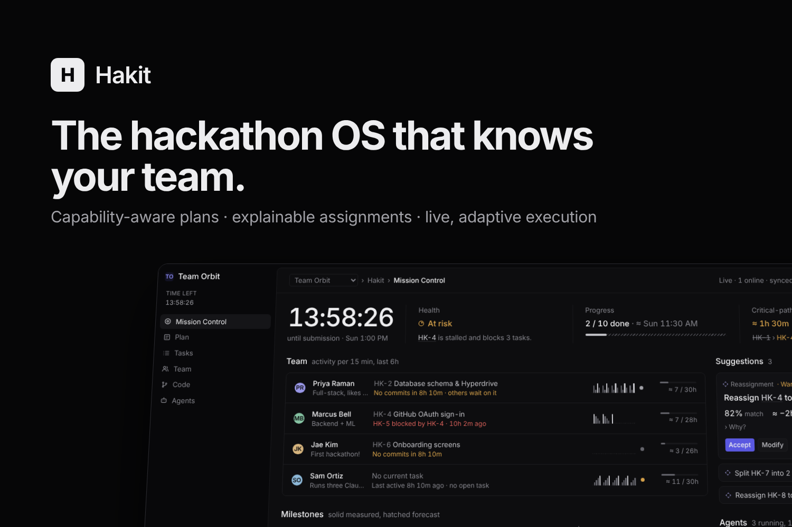
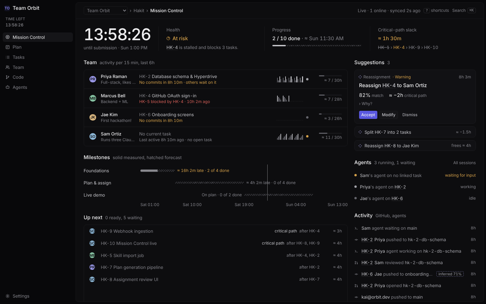
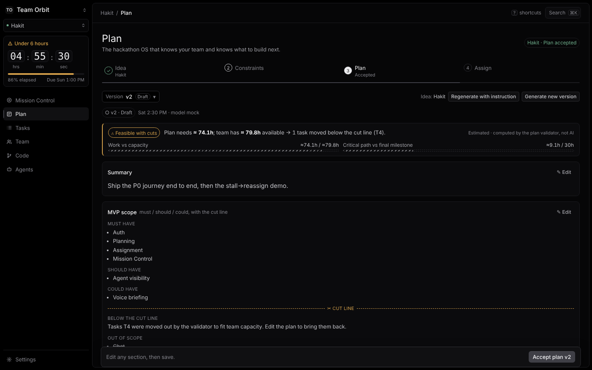
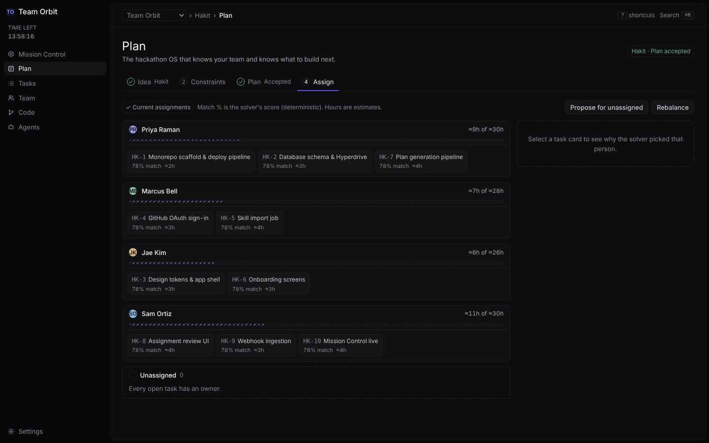
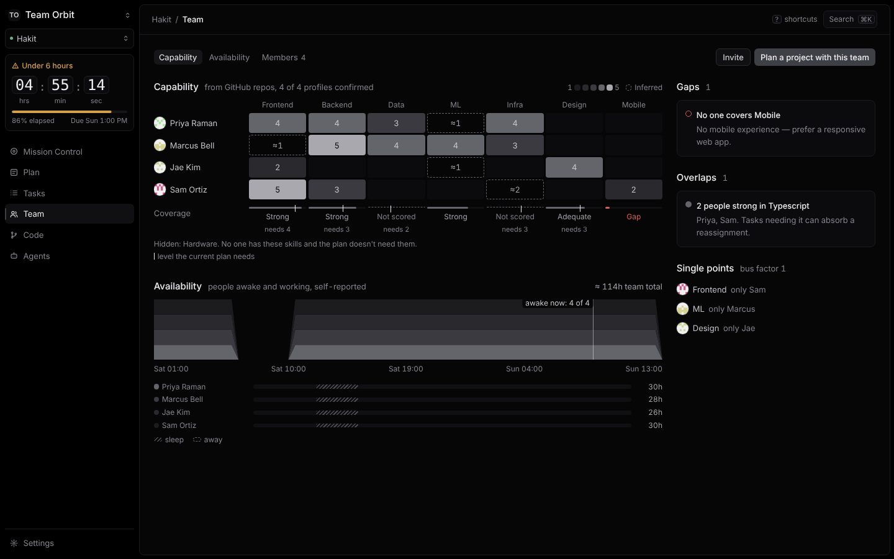
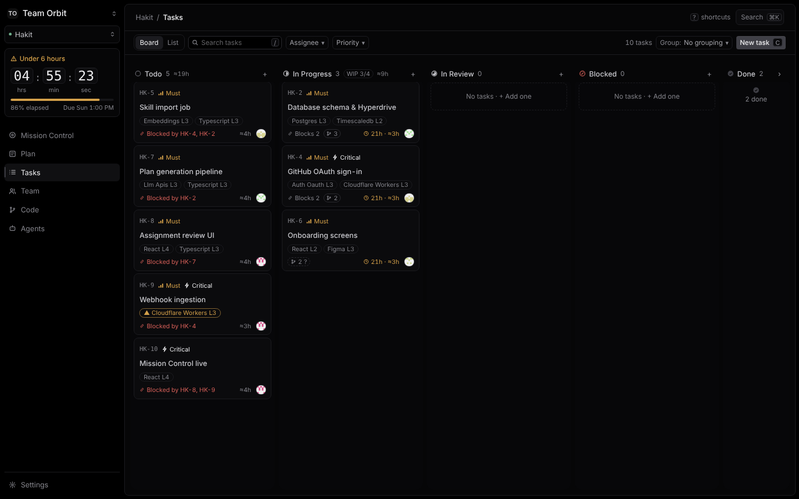
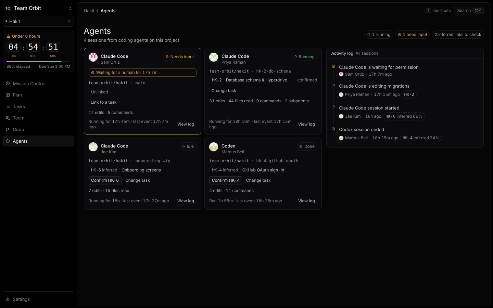

# Hakit



**The Hackathon OS that knows your team and knows what to build next.**

Hakit turns a group of people with different skills into a coordinated team. It plans around the team's real capabilities, assigns work with explanations, tracks live GitHub and coding-agent activity, and adapts the plan as the deadline approaches.

## What it does

- **Know the team.** Members import skills from their GitHub (languages, manifests, topics) and self-rate the rest; Hakit builds a capability profile with evidence and availability windows.
- **Plan what you can actually ship.** Ideas and plans are grounded in the team's skills and hours left. The engine validates every plan (DAG, task sizes, capacity) and draws a cut line instead of overcommitting.
- **Assign with reasons.** A solver matches tasks to people and every assignment explains itself: skill match, load, critical path.
- **Run it live.** Mission Control shows the countdown, health, critical-path slack, GitHub activity and Claude Code agent sessions in real time.
- **Adapt.** Rules catch stalled tasks, blocked chains, unavailable owners, workload imbalance and agents waiting on input, and propose a fix you can accept in one click.

Model output is never a decision: LLMs propose candidates and prose, the deterministic engine computes scores, hours, health and the critical path.

## Screenshots

| Mission Control | Plan review |
| --- | --- |
|  |  |
| **Assignment with explanations** | **Team capability** |
|  |  |
| **Tasks** | **Agents** |
|  |  |

More (including 375px mobile views) in [`docs/screenshots`](docs/screenshots).

## Stack

Cloudflare Workers (Hono, Durable Objects for real-time rooms, Queues, Cron), React + Vite, TigerData Postgres via Hyperdrive with Drizzle, Gemini and Hugging Face for generation and embeddings, a GitHub App for activity, and a Claude Code plugin for agent telemetry. Monorepo with pnpm: `packages/contracts` (Zod API contract), `packages/engine` (pure planning/solver/CPM/adaptive logic), `packages/db`, `packages/ui`, `packages/agent-plugin`, `apps/web`.

## Run it locally

```bash
pnpm install
cp apps/web/.dev.vars.example apps/web/.dev.vars   # HAKIT_MOCKS=1: fixtures, fake user, mock AI/GitHub
pnpm dev                                           # http://localhost:5173
pnpm typecheck && pnpm lint && pnpm test
```

Mock mode needs no accounts. For real GitHub, Gemini and database setup see [`docs/SETUP.md`](docs/SETUP.md).

Start with [`CLAUDE.md`](./CLAUDE.md) (conventions and ownership) and [`docs/SETUP.md`](./docs/SETUP.md) (accounts and secrets).

| Doc                                  | Contents                                                                |
| ------------------------------------ | ----------------------------------------------------------------------- |
| [PRODUCT](docs/PRODUCT.md)           | Requirements, journeys, priorities, differentiators                     |
| [COMPETITIVE](docs/COMPETITIVE.md)   | Hackord and adjacent tools, positioning                                 |
| [ARCHITECTURE](docs/ARCHITECTURE.md) | Cloudflare architecture, data model, API, real-time, jobs, security     |
| [DESIGN](docs/DESIGN.md)             | Brand, tokens, components, screen specs, accessibility                  |
| [AI](docs/AI.md)                     | Capability, planning, assignment and adaptive engines; model strategy   |
| [INTEGRATIONS](docs/INTEGRATIONS.md) | GitHub, Hugging Face, Gemini, TigerData, agents, Figma, ElevenLabs |
| [PHASES](docs/PHASES.md)             | Phased plan and post-hackathon roadmap                                  |
| [TASKS](docs/TASKS.md)               | Executable tasks with acceptance criteria                               |
| [HACKATHON](docs/HACKATHON.md)       | 36-hour schedule, checkpoints, demo script, fallbacks                   |
| [RISKS](docs/RISKS.md)               | Risks, mitigations, decisions awaiting approval                         |
| [DEMO](docs/DEMO.md)                 | Demo click-path, real-mode seed/swap/stall, fallbacks                   |
| [SUBMISSION](docs/SUBMISSION.md)     | Devpost write-up, built-with, capture checklist                         |
