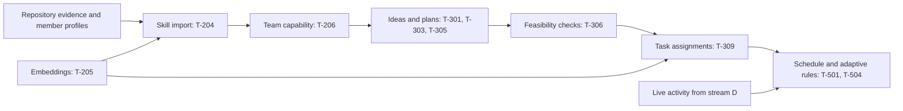

# T-205: Embeddings and your Intelligence role

Your workstream B owns the logic that understands the team, generates feasible plans, assigns tasks, and suggests changes when work falls behind. Platform owns authentication and database infrastructure, Frontend owns the screens, and stream D supplies GitHub/agent activity.

## How the pieces connect



This diagram describes the planned integration. T-205 supplies the embedding service and background job; it does not implement the later skill-import or assignment screens.

An embedding is a list of numbers representing text. Comparing those lists helps match phrases by meaning, such as “React experience” and “frontend development.” Similarity is an input to assignment scoring, not a probability that someone will succeed. The solver also needs skill levels, capacity, preferences, and dependencies.

## What was implemented

- HF primary: `Qwen/Qwen3-Embedding-0.6B` through HF's DeepInfra router.
- Optional AMD: OpenAI-compatible embeddings at your configured HTTPS `/v1` base URL.
- Workers AI fallback: `@cf/qwen/qwen3-embedding-0.6b`.
- Finite, nonzero, 1024-dimensional vectors, normalized consistently; incorrect models/dimensions fail safely.
- Query-only instruction prefix; document descriptions are embedded without it.
- Content-hash cache in the existing `embedding_cache` table. Query/document kind, actual instructed text, model, dimension, and format version affect the hash. Only misses are sent to providers; identical concurrent batches share a request within one service instance.
- Circuit breaker: three failures within 60 seconds skip a provider for two minutes, then allow one recovery probe. Breaker state is best-effort within a warm worker isolate and binding environment, not globally shared across deployments.
- `embed.batch` processes tasks as queries, taxonomy skills as documents, and member profiles/interests as documents. It uses chunks of at most 32 texts, writes using the existing schema, and supports redelivery without duplicate member vectors. Removed skills and departed members are excluded.
- Provider calls happen before the write transaction. Sources are rechecked before writing; changed task timestamps also reject stale writes. Concurrent profile/skill edits should continue enqueueing fresh jobs from their owning handlers. T-204/T-206 must enqueue member jobs when they implement those mutations.
- The HF deep-health probe now uses the same provider implementation, with its existing five-second timeout.

No schema, migration, shared contract, Wrangler setting, or secret was changed. The embedding model is deliberately fixed to Qwen3/1024 for persisted vectors; swapping models requires Platform's migration/re-embedding plan.

## What you can verify

From the repository root:

```bash
pnpm --filter @hakit/web test:embeddings
pnpm typecheck && pnpm lint && pnpm test
```

Automated tests use fake network providers and isolated WASM Postgres. They never contact Tiger or spend HF credits.

To make two small real HF requests using the token in `apps/web/.dev.vars`:

```bash
pnpm --filter @hakit/web check:embeddings
```

This needs Node with TypeScript stripping support (Node 22.6+). It prints the model, dimension, normalization, and similarity ranking for a React task compared with two fixed example profiles. It does not display the token or use real teammates' data. One verified run ranked the React profile at 0.7006 and the hardware profile at 0.3648; treat that as one sanity check, not a quality benchmark. Each invocation consumes a small amount of the account's inference credits.

## Your hands-on responsibilities

1. Configure your local `HF_TOKEN`; keep it out of chat and Git.
2. Have Platform put the deployment token into the worker secrets. Local secrets do not automatically deploy.
3. Run the focused tests and live example; inspect the named tests for expected behavior.
4. Coordinate PR review and later test realistic team scenarios, especially beginners, skill gaps, and limited availability.
5. Keep a demo story you can explain: repository evidence informs skills; embeddings compare meanings; tested rules check feasibility and constrain assignments.

AMD deployment requires a separate endpoint and credentials; HF credits alone do not establish AMD technology usage. Configure `AMD_EMBED_BASE_URL` as the HTTPS OpenAI-compatible base including `/v1`, and `AMD_LLM_KEY` as its bearer key. HF, AMD, and Workers AI must serve the same model and dimensions.

The repository's Cloudflare binding and Qwen model vars already exist. Local live Workers AI calls require Platform's Cloudflare setup and remote-binding access; AMD/Workers AI have only been tested through stubs here. Production Tiger/Queue behavior remains an integration check.

If all model providers fail, the service returns a typed unavailable error. Calling matching code can then use deterministic keyword/alias matching or retry. It never fabricates vectors and labels them as Qwen output. Input is limited to 32 nonempty strings of 16000 characters per service call; use summaries, not raw source code.

## Files to understand

- `services/embeddings/providers.ts`: sends requests and checks returned vectors.
- `services/embeddings/router.ts`: selects providers and tracks failures.
- `services/embeddings/cache.ts`: avoids paying again for identical text.
- `services/embeddings/index.ts`: wires the real service lazily, so missing AI configuration cannot break unrelated routes.
- `jobs/embed-batch.ts`: loads relevant database text and persists computed vectors.
- `scripts/check-embeddings.mjs`: your safe live verification command.

These paths are under `apps/web/src/worker`, except the script under `apps/web/scripts`.

Provider shapes follow the [official HF DeepInfra adapter](https://github.com/huggingface/huggingface.js/blob/main/packages/inference/src/providers/deepinfra.ts) and [Workers AI Qwen documentation](https://developers.cloudflare.com/workers-ai/models/qwen3-embedding-0.6b/).
